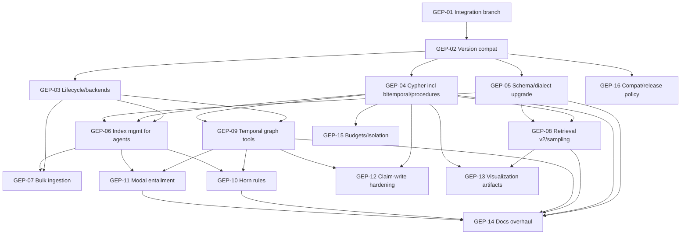

# Epic: GestaltDB agent backend — full graph + Cypher + temporal/epistemic coverage

Tracking: new EPIC for `langchain-gestaltdb` post-bootstrap.
Bootstrap context: `PROJECT_BOOTSTRAP_EPIC.md` (BST-01–BST-12, all complete, `0.1.1` released).
Upstream orientation (installed package, no source checkout required):

```bash
uv run --locked python -m gestaltdb.agent_docs list
uv run --locked python -m gestaltdb.agent_docs get quickstart
uv run --locked python -m gestaltdb.agent_docs get cypher --examples
uv run --locked python -m gestaltdb.agent_docs get backends
uv run --locked python -m gestaltdb.agent_docs get indexing
uv run --locked python -m gestaltdb.agent_docs get sampling
uv run --locked python -m gestaltdb.agent_docs get ingestion
uv run --locked python -m gestaltdb.agent_docs get visualization
uv run --locked python -m gestaltdb.agent_docs get epistemic
uv run --locked python -m gestaltdb.agent_docs get temporal
uv run --locked python -m gestaltdb.agent_docs search '<API name>'
```

Reference: `gestaltdb==0.17.0` pinned in `pyproject.toml`
(`>=0.17.0,<0.18`); packaged guides above are the
source of truth for upstream behavior. `gestaltdb.graphdb.GraphDB/Node/Edge` are the only
supported imports (see `AGENTS.md`).

Status: complete. The G17-01–G17-12 slices ship in `0.2.0` on `main` (compat bridge,
lifecycle/Cypher/bitemporal reads, schema/index advice, bulk ingestion,
sampling, temporal tools, rules, modal entailment, visualization, docs),
tested against `gestaltdb==0.17.0`. The `0.1.x` line stays on the 0.12 pin.
All children closed, `0.2.0` published, and the integration/feature branches
deleted. See `docs/COMPAT_0_17.md`.

## 1. Outcome and scope

Allow LangChain agents using GestaltDB as a graph backend to effectively use GestaltDB
features — not just parameterized `MATCH/RETURN`, but:

- full supported Cypher (reads, writes gated, schema commands, procedures, bitemporal reads),
- graph lifecycle/backends/persistence/inspection,
- schema + indexes + constraints,
- incremental and bulk ingestion,
- typed traversal sampling and bounded retrieval,
- bitemporal temporal history,
- epistemic claims + Horn rules + modal entailment,
- visualization artifacts where they help agents/humans.

Ambitious but bounded: GestaltDB is in active development. Every item must state its
upstream version assumption, fail closed on unsupported backends/serializers/index states,
and never promise universal atomicity, snapshots, native async, execution timeouts from
output caps, or multitenant sandboxing (existing `TECH_DEBT.md` TD-04 boundary stays).

## 2. Integration branch

All work below flows through one long-lived integration branch until merge to `main`:

- Name: `integration/gestalt-agent-backend`.
- Branched from current `origin/main`. Never push directly to `main` (per `AGENTS.md`).
- Feature work branches from the integration branch:
  `feat/GEP-04-cypher-temporal-reads`, `fix/GEP-02-version-compat`, `docs/GEP-14-docs-overhaul`.
- PRs:
  - feature → `integration/gestalt-agent-backend` (fast review, CI must pass),
  - integration branch → `main` only via small, reviewable slices with `Refs`/`Closes` links,
    strict/up-to-date `CI gate`, resolved conversations, squash-merge, branch deletion for
    feature branches (integration branch itself is not deleted until the EPIC closes).
- CI on the integration branch is the same required gate as `main` (ruff, mypy strict,
  Python 3.10–3.13, lowest-direct/latest, wheel-installed tests, LMDB/LevelDB/PyRex contracts,
  offline examples, >=90% coverage). No `pull_request_target`, no publishing secrets, no paid
  model credentials in required CI.
- Release policy unchanged: merging (to either branch) never authorizes publication.
  Each release needs explicit maintainer authorization via `publish.yml` on `main`.

## 3. Implemented functionality review (baseline)

| Area | File | What exists | Gap for agents |
| --- | --- | --- | --- |
| Lifecycle/query | `langchain_gestaltdb/graph.py` | `GestaltDBGraph` borrow/create/open, owned-handle close, `query()` + `query_read_only()`, `read_snapshot` passthrough, JSON normalization | No `manifest`/`database_id`/`read_view`/`current_read_view`/`transaction` surfacing; no serializer/backend matrix help beyond `pyrex` default |
| Schema | `langchain_gestaltdb/_schema.py` | Bounded canonical scan (100 nodes/100 edges + endpoints), truncation flag, `index_statistics()`, `DIALECT_GUIDANCE`, override/exhaustive options | Guidance predates bitemporal Cypher, constraints, procedures, temporal-index staleness; no constraint/index DDL introspection beyond index names |
| Read-only boundary | `langchain_gestaltdb/_read_only.py` | Recursive AST allowlist, subquery/UNION recursion, depth 32, length 10000, procedure allowlist (`pg.sample_typed_paths`, `kg.entails`) | Must be extended for `FOR VALID_TIME/SYSTEM_TIME`, `versionId/validFrom/validTo/systemFrom`, `SHOW CONSTRAINTS/INDEXES`, `kg.entails` options; revisit on every upstream minor (TD-03) |
| Tools | `langchain_gestaltdb/tools.py`, `toolkits.py` | `GestaltDBSchemaTool`, `GestaltDBQueryTool`, `GestaltDBToolkit`, app-controlled caps/permissions, redacted errors, bounded JSON | No temporal/read-view tool, no index/constraint helper, no sampling-pattern tool, no visualization artifact tool |
| Ingestion | `langchain_gestaltdb/_ingestion.py`, `graph_document.py` | `GraphNode/Relationship/Document`, `from_external()`, `__lc_int__`/`__lc_str__` collision safety, label union/shallow merge, parallel-edge identity, `MENTIONS`/`__LangChainSource__` | Object writes only; no Arrow/Polars bulk path, no `IndexMaintenanceMode` choice, no chunk/dtype guidance (TD-02 context) |
| Retrieval | `langchain_gestaltdb/retrievers.py` | `GestaltDBRetriever` + `RetrievalHop`, one-seed-strategy rule, `sample_neighbors` loop, hop/fanout/entity/content caps, deterministic non-ranking order, source linking | Single-hop loop only; no `sample_typed_paths`/`sample_typed_subgraph`/`SamplingPattern` exposure; no temporal/snapshot-aware retrieval |
| Claims read | `langchain_gestaltdb/claims.py` | Status/search/explanation, four-valued status, bitemporal horizons, bounded envelopes, history-preserving IDs | No rule/modal tools; explanation already covers rule derivations but there is no rule lifecycle |
| Claim writes | `langchain_gestaltdb/claim_writes.py` | Opt-in assert/correct/retract, explicit agent/provenance/validity, commit receipts, orphan-target guards (upstream #111), logical-ID correction (upstream #110) | Needs temporal-index rebuild guidance; no `create_rule`/`run_rules`/`maintain_truth` agent path |
| Docs | `README.md`, `docs/API.md`, `examples/` | Offline examples, contract docs, provenance notes | See §5 quality issues: duplication, missing workflow, missing temporal/rules/modal/sampling/bulk/viz guidance |

## 4. Priorities and dependencies

**P0:** foundation + correctness on current upstream. **P1:** agent-effectiveness (graph/Cypher/
temporal/epistemic). **P2:** experience, scale, hardening. Check an item only when its
acceptance criteria pass **and** its PR(s) are merged to the integration branch (and then to
`main` per slice).



### GEP-01 / P0 — Integration branch and slice plan

- Create `integration/gestalt-agent-backend` from `origin/main`.
- Document slice order (GEP-02 first, then GEP-03/04/05 independently, then P1 in DAG order).
- Acceptance: branch exists, CI runs on it, first slice PR targets it and passes `CI gate`.

### GEP-02 / P0 — Upstream version compatibility (blocks GEP-03–GEP-05)

- Probe installed `gestaltdb` minor upgrades against the full suite; record facade behavior
  (matching version strings do not prove source identity — verify by installed release).
- Revisit TD-01 (typed boundary: narrow stubs or adopt upstream `py.typed` if available),
  TD-02 (JSON bulk edge path: benchmark before adopting), TD-03 (AST coupling: review on every
  upstream minor; never call private `_plan_has_writes`).
- Add explicit unsupported-version failure (no silent fallback) and a backend/serializer
  compatibility matrix in docs.
- Acceptance: matrix documented, `uv.lock` decision recorded, TD entries updated with links.

### GEP-03 / P0 — Graph lifecycle, backends, persistence, inspection

Upstream (`backends` guide): `GraphDB.create(path, backend, serializer, ...)`,
`GraphDB.open(path)`, `manifest`, `database_id`, `read_view(valid_time=...)`,
`current_read_view()`, `read_snapshot=True/False`, `close` in `finally`, no whole-graph
enumeration (use `nodes_by_label`/`edges_by_type` + `get_node`/`get_edge`), byte-ID decoding
via `key_to_string`, unordered lookup/traversal sets.

- Surface read-only inspection helpers on `GestaltDBGraph` where safe:
  `manifest`/`database_id` passthrough, `stale_indexes`/`index_statistics` exposure,
  documented `read_snapshot` require/opt-out semantics per backend
  (LMDB MVCC vs transactional PyRex vs LevelDB/default-PyRex rejection).
- Document backend/serializer extras independently (`leveldb`/`lmdb`/`rocksdb`,
  `msgpack`/`protobuf` when applicable); keep `pyrex` default, explicit override only.
- Acceptance: agents can inspect persistence/index state without raw-handle access;
  backend-specific snapshot limits tested per backend contract job.

### GEP-04 / P0 — Cypher coverage for agents (core of this EPIC)

Upstream (`cypher` guide) supported — all must be reachable or explicitly gated:

- Patterns: labels, inline property maps, `{id: $id}` entity-ID extension, typed/untyped
  traversal, anonymous elements, endpoint labels/properties, unanchored multi-hop,
  comma-separated parts, label expressions.
- Clauses: `MATCH`/`OPTIONAL MATCH`/`WHERE`/`WITH` (scope replacement + local
  `WHERE/DISTINCT/ORDER BY/SKIP/LIMIT`)/`UNWIND`/`RETURN` (aliases, `*`, projections,
  `DISTINCT`, alias-aware `ORDER BY`, literal/parameterized `SKIP/LIMIT`)/`UNION [ALL]`/
  correlated `CALL { ... }`.
- Predicates/expressions: arithmetic/comparison, `NOT/AND/XOR/OR`, `IN`, null/string/`=~`
  predicates, three-valued null logic (`IS NULL`), strict Boolean/null predicate contexts,
  stable `ORDER BY` (nulls last ASC / first DESC), general projections, core aggregates
  `count/collect/sum/avg/min/max` (+`count(*)`, `DISTINCT` aggregates, implicit grouping keys,
  `ORDER BY` must reference projected outputs in aggregate queries).
- Paths: relationship property maps, variable-length + shortest paths, path bindings,
  legacy `*min..max` (GQL quantifiers unsupported — map error to legacy hint).
- Writes (gated): `CREATE/SET/REMOVE/DELETE/DETACH DELETE/MERGE`, write-only `FOREACH`;
  agent writes only via explicit `allow_writes=True`, never by default.
- Schema commands: `SHOW INDEX/INDEXES` (entityType/properties records), `CREATE CONSTRAINT`
  /`DROP CONSTRAINT`/`SHOW CONSTRAINTS` (persisted single-property node `UNIQUE` + `IS NOT NULL`,
  enforcement on Cypher writes).
- Procedures: generalized `CALL name(...) YIELD field [AS alias] RETURN alias`; allowlist
  `pg.sample_typed_paths` (parameterized) and bounded `kg.entails`
  (`world` + `validTime` required, `systemTime` optional); reject all else by default.
- Temporal types: `date/time/localtime/datetime/localdatetime/duration` recursive persistence
  across serializers + exact/range index interplay.
- Bitemporal reads: `FOR VALID_TIME AS OF <datetime expr>` (+ optional
  `FOR SYSTEM_TIME AS OF ...`) immediately after `MATCH`/`OPTIONAL MATCH`; query-wide
  qualifiers through chains/paths/unions/subqueries; system time requires valid time;
  repeated values must agree; qualified queries cannot write; one stable read view;
  require current temporal indexes (rebuild deferred first).
- Temporal functions: `versionId/validFrom/validTo/systemFrom` (null for null/unqualified
  current entities; `validTo` null for open intervals).
- Index reuse: configured exact/range node + typed relationship indexes reused where predicates
  permit (document, do not over-promise planner behavior).

Work:

- Extend `_read_only.py` allowlist + tests for temporal qualifiers/functions, schema commands
  (read-only `SHOW` allowed; `CREATE/DROP CONSTRAINT` rejected unless `allow_writes`), and
  `kg.entails` option validation.
- Extend `_serialization.py` for temporal values (exact `$type` + fields, ISO strings where
  specified, recursive persistence parity).
- Extend `_schema.py` dialect guidance with supported/unsupported lists above + GQL-hint mapping.
- Acceptance: matrix test per bullet (positive + adversarial state-unchanged), procedure tests
  with `allowed_procedures`, temporal tests with stale-index failure + rebuild recovery.

### GEP-05 / P0 — Schema, dialect, and staleness contract

- Include index definitions, endpoint labels, temporal-index currency, and constraint summaries
  in structured schema (still bounded; explicit `None` = exhaustive opt-in).
- Canonical reads bypass stale secondary indexes; indexed queries require
  `rebuild_deferred_indexes()` after external deferred import — integration never silently
  rebuilds; surface `stale_indexes` in schema metadata and tool errors.
- Acceptance: schema tests for truncation, override, stale-index signaling, dialect text
  covering §GEP-04.

### GEP-06 / P1 — Index management for agents (depends GEP-03/04/05)

Upstream (`indexing`): explicit `create_node_property_index`/`create_edge_property_index`,
exact/range lookups, `None` = unbounded endpoint, unordered results, deferred-ingest rebuild
(`rebuild_deferred_indexes()` unless `DEFER_REBUILD`).

- Read-only index advisor tool (or schema-tool extension): which property index would serve a
  planned predicate, whether it exists, whether it is stale, exact rebuild call for the
  trusted app. Agents never DDL directly.
- Acceptance: advisor tests on LMDB/LevelDB/PyRex; deferred-ingest stale → fail-closed → rebuild
  → success path tested.

### GEP-07 / P1 — Bulk ingestion (depends GEP-03/GEP-06)

Upstream (`ingestion`): object writes for small updates; Arrow/Polars bulk loads;
`IndexMaintenanceMode.MAINTAIN/DEFER/DEFER_REBUILD`; CSV pitfalls (explicit numeric dtype,
`labels` list re-wrap).

- Add trusted-app bulk helper (not an agent tool by default): Arrow/Polars frame validation,
  `index_mode` choice, chunking, partial-write reporting, schema-cache invalidation, no
  whole-import atomicity promise.
- Acceptance: bulk tests with deferred + rebuild, CSV round-trip dtype test, TD-02 benchmark
  before enabling JSON bulk edge fast path.

### GEP-08 / P1 — Retrieval v2 and sampling (depends GEP-04/GEP-05)

Upstream (`sampling`): `sample_neighbors`/`sample_typed_paths`/`sample_typed_subgraph`,
`SamplingHop`/`SamplingPattern`, byte-ID records (`edge_id/neighbor_id/source_id/target_id/
edge_type/direction`), deterministic small-assertion behavior when `sample_size` exceeds
neighbors; snapshot/engine (`SamplerSnapshot`/`SamplerEngine`, compact IDs, `to_external`,
temporal contexts — ML bridge, not an agent ranking claim).

- Expose multi-hop `SamplingPattern` tool (bounded hops/fanout, `rng` seed, byte→string decode),
  extend `GestaltDBRetriever` or add `GestaltDBSamplingTool` with same truncation/cap envelope.
- Document external vector-store seeding (resolver) without claiming a vector store.
- Acceptance: pattern tests (multi-hop, `any` direction, truncation flags), byte-decode tests,
  no fabricated entities, no index rebuild side effects.

### GEP-09 / P1 — Temporal graph tools (depends GEP-03/GEP-04)

Upstream (`temporal`): separate mutable vs versioned records, half-open `[start,end)` valid
intervals, inclusive commit-prefix system horizons, `read_view` pinning, deferred temporal
writes fail closed until `rebuild_temporal_indexes()`/`rebuild_deferred_indexes()`,
`TimeIndexedEdge` deprecated migration (`migrate_time_indexed_edges(delete_legacy=False)` →
  validate as-of reads → `delete_legacy=True`; backup + stop writers first; retries skip exact
  prior results), serializer-matched reopen, v1/v2 snapshot compatibility, orphan handling
  (`list_temporal_orphans` → bounded `reclaim_temporal_orphans(through_commit=...)`; commit IDs
  never reused; no pruning/TTL).

- Add read-only temporal tools: `get_node_as_of`/`get_edge_as_of`/`iter_nodes_as_of`/
  `iter_edges_as_of` wrappers with bitemporal horizons + pinned `read_view` where multi-read
  consistency matters.
- Document migration/orphan/recovery as trusted-app runbooks, not agent tools.
- Acceptance: as-of tests (open/closed intervals, system horizons), stale-temporal-index
  fail-closed test, `read_view` shared-horizon test.

### GEP-10 / P1 — Horn rules (depends GEP-06/GEP-09)

Upstream (`epistemic` rules): `create_rule(name, when=[...], then=...)` (safe positive Horn;
head vars bound in body; constant predicates), `run_rules(as_of=...)` (positive entity-claim
join within one world, validity intersection, `gestaltdb:rules` conclusions with
rule/premise justifications), `max_iterations/max_derivations/max_justifications` bounds
(limit error persists no partial conclusions; unchanged rerun idempotent),
`maintain_truth(as_of=...)` (independent supports, justification correction, retract-after-last-
support; later calls may omit `as_of`), `explain_claim` already covered.

- Add rule-read tools + opt-in rule-write toolkit mirroring claim writes (explicit bounds,
  append-only, no inferred authority).
- Acceptance: rule lifecycle test (create → run → explain → maintain → retract-after-last-
  support), bound-exhaustion no-partial-conclusions test.

### GEP-11 / P1 — Modal/belief entailment (depends GEP-06/GEP-09)

Upstream (`epistemic` modal): `assert_world_accessibility(agent, from_world, to_world, kind)`
(`belief`/`knowledge`/`modal` frames), `entails(agent, proposition, mode, world, valid_time)`
(`BELIEVES/KNOWS/POSSIBLE/NECESSARY`, one pinned read view, finite `max_depth`/`max_states`),
formulas (atoms + `NOT/AND/OR` + nested modals, four-valued paraconsistent; missing
accessibility = `unknown`; contradictions do not explode), `CALL kg.entails(...) YIELD status,
confidence, explanation` (requires `world` + `validTime`, optional `systemTime`).

- Add bounded `entails` tool (read-only by default; world-accessibility writes opt-in only).
- Acceptance: four-valued tests, unknown-accessibility test, bound tests, `kg.entails`
  parity test with direct API.

### GEP-12 / P1 — Claim-write hardening (depends GEP-04/GEP-09)

- Keep opt-in assert/correct/retract; add temporal-index rebuild guidance after deferred claim
  writes, `through_commit` vs `system_time` documentation, no-delete invariant tests.
- Acceptance: deferred-claim-write stale → rebuild → read test; receipt-truncation
  no-retry-on-success test.

### GEP-13 / P2 — Visualization artifacts (depends GEP-04/GEP-08)

Upstream (`visualization`, offline, no JS toolchain/network): `gestaltdb.viz.api`
(`visualize_nodes_edges/query/sample/sampler_batch`, `graph.visualize(cypher/seeds+pattern)`),
`VizOptions` (caps 2000 nodes/5000 edges, ceilings 2×, theme/layout/labels/filters),
`VizFigure` (`save/as_html/_repr_html_`, `as_svg/save_svg` circle/grid/positions),
`TruncationWarning` + on-canvas banner, `VizCapExceededError` → sampling alternative,
saved view-state JSON (16 MB local limit, topology-validated).

- Add opt-in artifact helper (trusted app writes HTML/SVG to explicit path; agent receives
  bounded summary + path, never raw HTML by default).
- Acceptance: offline artifact tests with caps/banners, no network/JS dependency in CI.

### GEP-14 / P2 — Documentation overhaul (depends GEP-04/05/08/09/10/11)

Quality issues to fix (observed in `README.md`/`docs/API.md`/`examples/`):

- Consolidate repeated deployment-limit disclaimers into one “Limits” page; link from tools.
- Add agent workflow (schema → index check → query/sample/retrieve → temporal/claim check →
  explain) with decision tree (Cypher vs retriever vs claim search vs entails).
- Document exact-match/fuzzy seeding, truncation envelopes, full-catalog-scan cost,
  stale-index recovery, `read_snapshot` per-backend behavior, CSV dtype pitfalls.
- One runnable example per tool class (query, schema, retriever, claim read, claim write,
  temporal read, rules, entails, sampling, visualization) with expected truncated output.
- Refresh `DIALECT_GUIDANCE` + `docs/API.md` on every upstream minor; add agent_docs diff
  checklist to PR template.
- Acceptance: docs CI (link check, example run, dialect-vs-upstream consistency test).

### GEP-15 / P2 — Execution budgets and isolation (TD-04 exit)

- Cooperative cancellation or process-isolated execution mode with tested budget exhaustion,
  handle cleanup, persistence integrity, measured limits. Output caps stay output-only.
- Acceptance: budget-exhaustion test, no thread-interrupt unsafety, hostile-read deployment
  guide. Not a multitenant sandbox claim.

### GEP-16 / P2 — Compatibility and release policy for active upstream

- Version policy: pinned minor + verified upgrade PRs; extras for backends/serializers;
  `uv.lock` committed; minimum/latest dependency CI preserved.
- Reuse `publish.yml` Trusted Publishing on `main`; integration branch never publishes.
- Acceptance: policy section in `docs/RELEASING.md` referencing this EPIC; TD-05 badge
  automation only if secret policy allows.

## 5. Non-goals (unless separately approved)

Native vector search, generic chat-history stores, custom QA chains, ML sampler/engine
wrappers beyond documented bridging, live NetworkX sync / dynamic GEXF, in-place snapshot
upgrades, temporal pruning/TTL, power-loss/crash-recovery certification, native async,
automatic index creation by agents, per-claim authentication/authorization (trusted app owns
policy — supplying identities never authenticates).

## 6. Test and acceptance contract (per GEP)

- Offline fixtures, temporary DB paths, `try/finally` close; fake models only; no paid
  credentials; no whole-graph enumeration in tests.
- Backend matrix: LMDB/LevelDB/PyRex where behavior differs (snapshots, deferred indexes,
  temporal indexes); missing libraries fail visibly, no blanket skips.
- Adversarial read-only tests: state-unchanged after rejected writes/DDL/procedures,
  including subqueries/UNION/temporal qualifiers.
- Coverage >=90% package; new tools include `langchain-tests` standard suites where applicable.
- Docs updated in the same PR as behavior; epic checkboxes updated on merge, not on local code.
