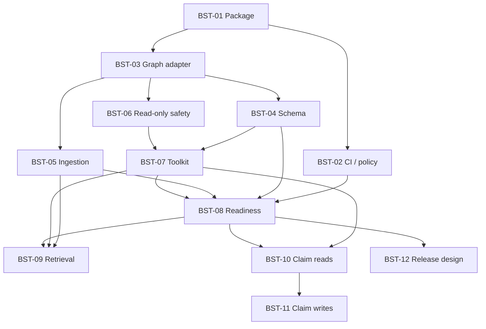

# Epic: bootstrap langchain-gestaltdb

Tracking epic: [GitHub #1](https://github.com/mylonasc/langchain-gestaltdb/issues/1).
GitHub is the agreed host for issues, CI, and PRs (the equivalent of GitLab MRs).

## Outcome and release scope

Build a small, graph-first LangChain integration: a typed `GestaltDBGraph`
adapter, predictable graph-document ingestion, and safe read-only agent tools.
Follow with bounded typed-graph retrieval and provenance-aware temporal claims.

The first release candidate scope is **BST-01 through BST-08**. BST-09 through
BST-11 are follow-on features. **Publishing automation is deferred to BST-12**;
this epic does not authorize tags, GitHub Releases, or package uploads.

## Research and constraints

GestaltDB was cloned outside this repository to
`/tmp/opencode/gestaltdb-bootstrap-inspection` and superficially inspected at
commit `a334e59f3e587ec685360a8c1cc4a05aa33c1010`. Its declared version and the
installed PyPI version are both 0.12.0. API behavior must be verified against
the installed release; matching version strings do not prove source identity.
Reviewed material includes `AGENTS.md`, packaged agent guides/API index,
project metadata, and Cypher parser/planner/execution interfaces.

Findings that drive priority:

- Python support is `>=3.10,<3.14`; prefer Python 3.12 for development.
- Native labels, typed relationships, parameterized Cypher reads/writes,
  property indexes, typed paths, and subgraph sampling already exist.
- `GraphDB.create/open` provides manifest-backed persistence. Base installation
  has no backend; explicitly select an installed backend. Use LMDB/JSON in
  bootstrap tests; keep backend choices additive and never silently fall back.
- Schema discovery must include graph structure/properties, not merely index
  definitions. Default to bounded inspection, with explicit exhaustive/override
  options and a documented sampling contract.
- Mutable property graph, immutable temporal history, and epistemic claims are
  separate models. Claims do not automatically appear as Cypher edges.
- Claim provenance, contradictions, historical corrections/retractions, and
  four-valued status are strong differentiators for agents.
- No native vector search was found in the inspected interfaces. A vector-store
  wrapper is therefore not a bootstrap deliverable.
- Snapshot and transaction guarantees vary by backend. Do not promise universal
  atomicity, native async, or a computational timeout from an output row cap.

Installed-package orientation (no source checkout required):

```bash
uv run --locked python -m gestaltdb.agent_docs list
uv run --locked python -m gestaltdb.agent_docs get quickstart
uv run --locked python -m gestaltdb.agent_docs get cypher --examples
uv run --locked python -m gestaltdb.agent_docs search sample_typed_subgraph
```

Reference sources: [GestaltDB](https://github.com/mylonasc/gestaltdb),
[PyPI metadata](https://pypi.org/pypi/gestaltdb/json),
[CLI 0.0.37](https://pypi.org/project/langchain-cli/0.0.37/), and
[Neo4j's graph-store protocol](https://github.com/langchain-ai/langchain-neo4j/blob/main/libs/neo4j/langchain_neo4j/graphs/graph_store.py).
Graph-store interfaces are integration-specific, not a universal Core API;
compatibility claims require dedicated tests, not an unconditional Community dependency.

## Bootstrap approach

1. Generate selected `langchain-cli==0.0.37` template files in a disposable
   directory using Python 3.12. Full generation refuses existing destination
   directories and runs `poetry install`; selective `--src/--dst` avoids both.
2. Replace legacy Poetry/Core 0.3 configuration with PEP 621, uv, Hatchling,
   `langchain-core>=1.0,<2`, and initially `gestaltdb>=0.12.0,<0.13`.
3. Preserve the repository's Apache-2.0 license; do not copy the template's MIT
   license or unrelated provider/embedding/vector-store stubs.
4. Commit `uv.lock`; keep only Core and GestaltDB mandatory at runtime. Expose
   explicit backend extras and keep models, Community, Classic, and LangGraph
   optional unless an implemented contract proves them necessary.
5. Ship a minimal typed namespace and dependency/persistence smoke tests first,
   then implement adapters through separate issues/PRs. Do not export fake APIs.

The selective generation was run as:

```bash
uvx --python 3.12 --from langchain-cli==0.0.37 langchain-cli integration new \
  --name gestaltdb --name-class GestaltDB \
  --src pyproject.toml --dst pyproject.toml
```

The host defaults to free-threaded Python 3.14, which caused the legacy CLI's
`orjson` dependency to fail to build. Explicit Python 3.12 generation succeeded;
do not change this project's supported range to accommodate that host default.

## Indexed, prioritized checkpoints

**P0:** first-release scope. **P1:** next capabilities. **P2:** deferred work.
Check a checkpoint only after acceptance criteria pass **and its PR is merged**.
Bootstrap files can exist on an open PR while BST-01/BST-02 remain unchecked.
The linked issues contain the full acceptance checklists and reverse links.

- [x] **BST-01 / P0 — Package foundation** — [#2](https://github.com/mylonasc/langchain-gestaltdb/issues/2). Merged in PR #14. Selective scaffold, modern metadata, explicit extras, lockfile, `py.typed`, wheel/sdist, real LMDB persistence and import tests.
- [x] **BST-02 / P0 — CI and protected PR policy** — [#3](https://github.com/mylonasc/langchain-gestaltdb/issues/3). Merged in PR #14. Python matrix, quality/typing, minimum-direct dependencies, installed-wheel checks, required stable gate, protected main, contributor/release instructions.
- [ ] **BST-03 / P0 — Graph lifecycle/query adapter** — [#4](https://github.com/mylonasc/langchain-gestaltdb/issues/4). Blocked by **BST-01**. `GestaltDBGraph`, parameterized record output, explicit create/open, owned/borrowed handles, deterministic nested entity/ID/temporal normalization.
- [ ] **BST-04 / P0 — Schema and dialect** — [#5](https://github.com/mylonasc/langchain-gestaltdb/issues/5). Blocked by **BST-03**. Text/structured schema, refresh/cache contract, bounded inspection, explicit overrides, supported-Cypher guidance.
- [ ] **BST-05 / P0 — Graph-document ingestion** — [#6](https://github.com/mylonasc/langchain-gestaltdb/issues/6). Blocked by **BST-03**. Native labels/types, collision-safe identity, defined upserts and parallel edges, source documents/MENTIONS, optional external type compatibility.
- [ ] **BST-06 / P0 — Read-only security boundary** — [#7](https://github.com/mylonasc/langchain-gestaltdb/issues/7). Blocked by **BST-03**. Recursive parsed-query validation, procedure allowlist, mutation/DDL rejection, adversarial state-unchanged tests. Prefer a public upstream classifier; isolate private/version-sensitive parsing if unavoidable.
- [ ] **BST-07 / P0 — Agent tools/toolkit** — [#8](https://github.com/mylonasc/langchain-gestaltdb/issues/8). Blocked by **BST-04, BST-06**. `GestaltDBSchemaTool`, `GestaltDBQueryTool`, `GestaltDBToolkit`, typed inputs, parameters, bounded output, read-only defaults, explicit write opt-in, offline invocation/standard tests.
- [ ] **BST-08 / P0 — First-release readiness** — [#9](https://github.com/mylonasc/langchain-gestaltdb/issues/9). Blocked by **BST-02, BST-04, BST-05, BST-07**. End-to-end ingest/inspect/query example, minimum/latest dependency and optional-backend coverage, source provenance, lifecycle/serialization/stale-index regressions, accurate docs. No publishing authorization.
- [ ] **BST-09 / P1 — Bounded graph retriever** — [#10](https://github.com/mylonasc/langchain-gestaltdb/issues/10). Blocked by **BST-05, BST-07, BST-08**. `BaseRetriever`, indexed or supplied seed resolution, typed traversal, hop/fanout/entity/output caps, source-linked Documents, deterministic tests. External vector search may supply seeds.
- [ ] **BST-10 / P1 — Read-side epistemic tools** — [#11](https://github.com/mylonasc/langchain-gestaltdb/issues/11). Blocked by **BST-07, BST-08**. Claim status, source/agent/world filters, valid/system time, bounded provenance explanations, contradictory/historical evidence examples.
- [ ] **BST-11 / P1 — Opt-in claim writes** — [#12](https://github.com/mylonasc/langchain-gestaltdb/issues/12). Blocked by **BST-10**. Sourced assertion, correction, retraction; explicit authorization; history and identity tests; never silently infer authority or confidence.
- [ ] **BST-12 / P2 — Release pipeline design/approval** — [#13](https://github.com/mylonasc/langchain-gestaltdb/issues/13). Blocked by **BST-08**. Maintainer-approved version/tag/trigger strategy, review maintained LangChain workflows, consider OIDC/Trusted Publishing and protected environments, artifact validation, release runbook. Implementation/publication deferred.

### Dependency graph



BST-01 and BST-02 may be delivered jointly in the initial bootstrap PR; all other
dependencies remain normal merge prerequisites. Schema, ingestion, and safety
can proceed independently after the graph contract is stable.

### Initial delivery evidence (not completion)

[PR #14](https://github.com/mylonasc/langchain-gestaltdb/pull/14) delivers the
foundation and CI/policy checkpoints jointly. Its initial
[CI run](https://github.com/mylonasc/langchain-gestaltdb/actions/runs/39124002820)
passed all eight checks: quality, four Python versions, minimum direct
dependencies, installed wheel, and the aggregate gate. Later PR commits must
pass their own checks before merging; this link is historical evidence only.

Main protection is configured remotely with strict status checks bound to the
GitHub Actions app, administrator enforcement, PRs, resolved conversations,
linear history, and disabled force-push/deletion. Squash is the only enabled
merge method, and merged branches are automatically deleted. The initial
PR was merged after green CI under the maintainer's explicit merge authorization.

## CI, branch, and PR contract

See [AGENTS.md](AGENTS.md) for the operational instructions. In brief:

- Issue-scoped branches, small commits, PRs to `main`, squash merge, branch deletion.
- Protected main requires up-to-date `CI gate`, PRs, resolved conversations, and
  administrator enforcement; force-push and deletion disabled.
- Zero mandatory approvals during solo maintenance; request review when possible
  and require one approval when a second active maintainer is available.
- Required CI: lint/format/typing; Python 3.10–3.13 tests; minimum direct runtime
  dependencies; build/metadata validation and wheel-installed tests outside checkout.
- No path filters, publishing credentials, paid APIs, or `pull_request_target`.
- PRs merge only after green CI and authorization; issues stay open until merged.

## Technical debt

See [TECH_DEBT.md](TECH_DEBT.md) for stable TD IDs, linked follow-up issues,
safe interim approaches, and measurable exit criteria. Review it during BST-08.
Security, data-integrity, and required-test failures are not deferrable debt.

## Deferred, not implied by this epic

Native vector search, generic chat-message history/stores, a custom QA chain,
ML snapshot/sampler wrappers, Arrow/Polars convenience APIs, visualization,
Horn/modal reasoning toolkits, and native async are not bootstrap commitments.
Consider them only against demonstrated demand and separately approved issues.
